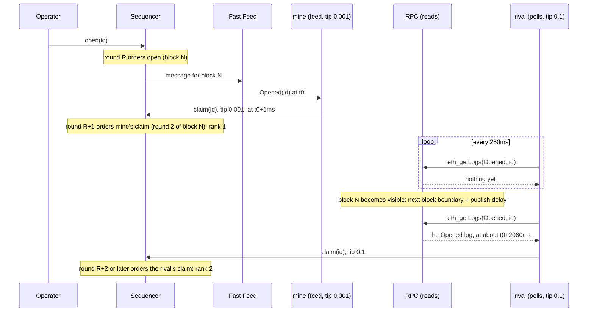

# Fast Feed + PGA together

Not production: teaching code, throwaway wallets only. This part combines the two features: the [Fast Feed](../fast-feed/README.md) tells you what happened, and [PGA ordering](../pga/README.md) decides who goes first next. Read those two first; this page only shows how they fit and does not re-explain either. Everything local runs on the [simulator](../sim/README.md), which states each difference from Arbitrum One once.

**Where the code is.** `combo/` is the only feature folder that imports both `fast-feed/` and `pga/`. `scenarios.ts` is the `npm run race` entry (S1-S3 and the matrix), `race.ts` the bots and the runner, `demo.ts` the narrated demo, `round2.ts` chapter 4's round-2 injection and tables plus chapter 5's staged comparison formatters and sequencer summary, `stages.ts` chapter 5's stage runner (the simulator hold, Enter prompts and fallback, with its effects injected), `slot.ts` the `pga:slot` demo. The `Race` contract is `contracts/src/combo/Race.sol`.

**Commands in order** (the full list is the [command reference](#command-reference)):

```bash
npm run demo -- --local --pause     # the whole story, presenting (Enter between chapters)
npm run demo -- --local             # the same, hands-off
npm run race -- --local --scenario s3                   # one race
npm run race -- --local --scenario matrix --trials 5    # all three, one table
npm run pga:slot -- --local         # demo 4 (with: npm run sim -- --block-ms 20000)
```

> **Information gets you into the round; the tip wins the round.**

Contents: [The full demo walkthrough](#the-full-demo-walkthrough) | [The game](#the-game) | [Scenarios](#scenarios) | [S1: the tip wins the round](#s1-the-tip-wins-the-round) | [S2: speed beats tip](#s2-speed-beats-tip) | [S3: the headline](#s3-the-headline-information-and-tip) | [Chapter 4 of the demo](#chapter-4-of-the-demo-one-block-two-rounds) | [The matrix](#the-matrix) | [How to run it](#how-to-run-it) | [`--local` vs `--testnet`](#--local-vs---testnet)

## The full demo walkthrough

`npm run demo -- --local` is glue only: it composes the banner, a key, a ticket, background traffic, the live view, a one-block story (round 2 held open for your tx) and race S3, and narrates them in 6 chapters. The chapter list, run time and exit codes are in the [root README](../README.md#run-the-full-demo); this section has the detail.

| Chapter | Concept |
| --- | --- |
| 1. What is accelerated | [simulator](../sim/README.md) |
| 2. Wallets and a feed key | [tickets and keys](../fast-feed/README.md#tickets-and-keys) |
| 3. A ticket | [timing](../fast-feed/README.md#timing-buy-in-round-n-active-in-round-n1-only) |
| 4. One block, two rounds: your tip goes first | [chapter 4](#chapter-4-of-the-demo-one-block-two-rounds), [live view](../fast-feed/README.md#live-view) |
| 5. The race | [S3](#s3-the-headline-information-and-tip) |
| 6. Recap | [the game](#the-game) |

What each chapter shows is in the chapter table of the [root README](../README.md#run-the-full-demo).

An excerpt (trimmed; hashes and timings vary):

```
▶ CHAPTER 4/6: One block, two rounds: your tip goes first
NOTE: Read more: pga/README.md#the-idea
==> block 14 — 250 ms on Arbitrum One (here 2 s)
==> round 1 — 125 ms on Arbitrum One (here 1 s) · 4 txs:
...
NOTE: Process slowed down for the demo: inserting a transaction with a bigger
      tip in round 2
...
==> round 2 — 125 ms on Arbitrum One (here 1 s) · 4 txs:
── block 14 · round 2 · 4 txs ──
   tx_index  from         to           bid (maxPriorityFee / maxFee)  effective tip     gas used   fee paid
>> 3         0xf39F…2266  0x0000…dead  1 / 2 gwei                     1 gwei            21000 gas  0.00002121 ETH  <- yours, tip 1 gwei, index 0 of round 2
   4         0x1CBd…C9Ec  0x0000…0d03  0.076159656 / 1.01 gwei        0.076159656 gwei  21000 gas  0.000001809352776 ETH
==> block 14 ordered and executed by the sequencer (sealed, visible on the RPC)
YOUR TX: block 14, round 2, first in its round (tip 1 gwei)
...
Mine: rank 1. Why: Fast Feed got us into block 17 round 2 (rival polled, arrived in block 18 round 1); our tip 0.2 also beat the rival's 0.1 (we'd also win a same-round tie).
```

The "why" is phrased from what the race judge observed: it never claims an effect it did not see (on a `--fifo` stack, for example, chapter 4 fails by name, "the running simulator orders by arrival (FIFO); restart without --fifo to see PGA", and the recap says PGA was not observed).

- **`--pause`** waits for Enter before each chapter, for presenting. On a stdin that is not a terminal (a pipe, `/dev/null`) it never waits: it prints a note and runs straight through. While a prompt waits, the simulator is frozen ([local only](../sim/README.md#pausing-and-skipping-the-clock): no rounds, no blocks, no traffic, a stopped ticket clock), so a long pause no longer uses ticket time and Enter continues in the same ticket round; the first pause prints a `NOTE:` saying so. If the simulator cannot be paused (another holder, an older simulator) the demo prints a `NOTE:` and falls back to the old behaviour: the ticket covers about two ticket rounds, so a long pause can outlast it, and the demo checks the ticket before chapters 4 and 5, renews it or buys a new one (and waits for it to activate), and reconnects the live view if the feed closed it (`1008`/`401`, named in the failure message if it still happens). The same check runs before chapters 4-5 whenever the ticket is about to run out, paused or not. After every Enter one line says how much of the current ticket round is left and whether the ticket was kept, renewed or rebought (`ticket round 7: 12s left · ticket kept`). When the demo started the simulator itself, it skips the simulator clock silently to the ticket's activation time as soon as the purchase has landed (an attached simulator is never skipped).
- **Slow motion for `--pause`.** On a terminal, `--pause` that starts its own stack runs it in slow motion ([`--slowmo`](../sim/README.md#k-rounds-per-block): B = 25s, rounds of 12.5s, ticket round 100s), so the live panel can be watched block by block; the run takes several minutes. `DEMO_SLOWMO=0` keeps the default preset (so does choosing `SIM_BLOCK_MS` or `SIM_SLOWMO`; a hands-off run, or `--pause` without terminals, always uses the default). When the demo attaches to a running `npm run sim`, it uses that simulator, prints its block and round times and, unless it is slow motion, `NOTE: for the slow-motion view restart the simulator with npm run sim -- --slowmo`.
- **Row pacing.** On a terminal, the demo shows the Fast Feed side of its PGA chapters (chapter 4's round 1 and round 2 tables, chapter 5's round 1 at stage 1 and round 2 at stage 2) as transactions arriving: the table header first, then 3 rows at once, the 4th a second later and the rest half a second after that. A reprint of a round already seen (stage 2's round 1) and the right-hand side (the whole sealed block) are not paced. It is display only, exaggerated on purpose (one `NOTE:` says so, once per run): the real feed delivers a round within milliseconds, and no measured value (FF lead, latency, timing tables) changes. Piped output is never paced; `DEMO_ROW_PACING=0` turns it off on a terminal too; Ctrl-C ends it at once.
- **Hands-off pace.** On a terminal it stops about 3s after each chapter; `DEMO_CHAPTER_DELAY_MS` changes it ([root README](../README.md#reading-the-output)).
- **Run time.** The background ticket purchase starts before chapter 1 prints. In slow motion it needs about 4 blocks (~100 s) of the presenter's time on chapters 1-2, and the simulator keeps running meanwhile: the `--pause` prompts do not freeze it until your ticket purchase and its renewal have settled (a `NOTE:` says so once), and a prompt that opened unfrozen freezes from the moment they have settled. When the demo starts the simulator itself, it [skips the simulator clock](../sim/README.md#pausing-and-skipping-the-clock) silently to the activation time as soon as the purchase has landed, so the activation costs no wait. The purchase itself needs mined blocks, which cannot be skipped: if it is still landing when chapter 3 starts, chapter 3 prints `waiting for the ticket purchase to land (up to ~Ns)` (only above 20 s). Chapter 3 ends with a boxed ticket card (what is in the ticket, how it is bought and spent; only the key hash, never the key). Chapter 3 reports the ticket as soon as it is active; the renewal for the next ticket round continues in the background and chapter 3 or, if it is still running, chapter 4 (after one `==> waiting for the background renewal…` line) says once how it ended (a failed renewal is left to the ticket check before the chapter). Against an attached `npm run sim` the demo never skips and waits up to one ticket round (30s by default; `TICKET_ROUND_SECONDS` changes it, `--slowmo` raises it to 4 x B). Then about 30s of chapters.
- **Ctrl-C** stops the traffic, the feed connection and the stack the demo started (Anvil included) and exits 130; a stack you started with `npm run sim` is left running.
- **The feed key** is `FEED_API_KEY` if set, otherwise generated in memory and never written. A `PRIVATE_KEY` wallet is shown by address but the demo acts with Anvil account 0. The streamed `[sequencer]` lines are not shown in the demo: chapter 5 ends with at most three `NOTE:` lines that summarise what the sequencer did (use `npm run sim` or `npm run race` to see them).
- **`--testnet`** is refused for now: the testnet demo comes with the testnet stage and needs funded wallets, tickets and a deployed `Race`.

## The game

A `Race` contract ([contracts/src/combo/Race.sol](../contracts/src/combo/Race.sol)) has a race `id`. The operator opens it with `open(id)`; after that, everyone may `claim(id)`, and claims are ranked 1, 2, 3, ... in the order the sequencer executes them. Rank 1 is the winner (`winner(id)`). Two bots want rank 1:

- **mine** learns about `Opened` from the **Fast Feed** through its own ticket and connection (see [tickets and keys](../fast-feed/README.md#tickets-and-keys));
- the **rival** learns about it either from its own Fast Feed connection or by **polling the RPC**, depending on the scenario.

What the Fast Feed can and cannot do:

- **It cannot jump a transaction that is already sequenced.** `open` is ordered in round R, and the feed publishes it only after that. Nobody can claim before `open`, and nothing the bots send can be placed ahead of it.
- **It does get you into the next round.** A bot that sees `Opened` at once is in round R+1's waiting list. A bot that learns about it later is in a later round, and **a tip cannot buy a round you are not in**.
- **Inside a round, the tip decides**, not the arrival time ([part 1](../pga/README.md#the-idea)).

Details that make the scenarios deterministic:

- Both claims are **pre-signed before the trigger** (explicit nonce, gas and fees), so nothing is estimated or signed at fire time. The gas is estimated against the not-yet-open race (where `claim` is cheap) plus a margin for the storage writes of a real claim; a Foundry test keeps the margin honest.
- `Race.claim` **never reverts**, so the result is always readable from events and `winner(id)`, never from a failed transaction. A late first-time claimer is recorded with a real rank (3, 4, ...) and never reverts; only a repeat claim (`AlreadyClaimed`) and a claim before `open` (`ClaimTooEarly`) are cheap no-ops that record nothing.
- The polling rival cannot see `Opened` before the block that holds it is visible on the RPC. Locally that is the next block boundary plus the publish delay ([block-reveal gating](../sim/README.md#block-reveal-gating)), and the poll interval adds up to one more period.

## Scenarios

| Scenario | Rival | Mine | Expected winner | Deciding effect |
| --- | --- | --- | --- | --- |
| **S1** (pure PGA) | Fast Feed, fires at once, tip 0.001 | Fast Feed, fires 50ms later, tip 0.1 | mine | **tip** (same round) |
| **S2** (speed beats tip) | polls the RPC every 250ms (`--poll-ms`), tip 0.1 | Fast Feed, tip 0.001 | mine | **information** (mine is in an earlier round) |
| **S3** (headline) | polls the RPC every 250ms, tip 0.1 | Fast Feed, tip 0.2 | mine | **both**: information AND tip (mine is earlier and pays more; it would also win a same-round tie) |

Tips are in gwei. Each scenario passes only when the effect it is about was **observed**, not merely when mine won:

- **S1** passes when mine ranks first in the same round (same block and same pga_round), the stack orders by PGA (`sim_info.ordering`) and the winner's landed tip is higher. On a FIFO stack where mine happens to be first the verdict is INCONCLUSIVE ("FIFO: arrival decided, not the tip"); with the rival first it is a FAIL.
- **S2** passes when mine ranks first and the rival's claim landed in a **later** round than mine (a later pga_round of the same block, or a later block). If the rival landed in the same round, it is INCONCLUSIVE whoever ranked first: the rival made it into mine's round, so information did not decide (rerun, or poll more slowly).
- **S3** passes when mine ranks first. The text says what was observed: "both" only when mine was in an earlier round, tipped more **and** the stack orders by PGA (so the tip would also have won a same-round tie). On a FIFO stack an earlier-round win is "information" only, and the tip is said not to count; a same-round win on a FIFO stack is INCONCLUSIVE. A same-round win on a PGA stack with the higher tip is "tip".

Exit codes: 0 PASS, 1 FAIL (the expected winner lost, or an error), 3 INCONCLUSIVE (retried once, both in a single run and in the matrix: a retried matrix trial still counts as one trial and the table says so; one that is still inconclusive after the retry is counted apart, never as a win), 2 usage.

## S1: the tip wins the round

Both bots see `Opened` on the Fast Feed. The rival sends first, with a low tip; mine sends 50ms later with a high tip (`--mine-delay-ms`). Both claims wait in the same waiting list and enter round R+1 together, where **mine's 0.1 gwei beats the rival's 0.001 gwei although it arrived later**. The Fast Feed got each bot into that round; it did not decide who won it.

```bash
npm run race -- --local --scenario s1
```

Expected output (hashes, ids, blocks and timings vary; `[sequencer]` lines come from the stack, or are summarised when the stack runs in another terminal):

```
==> timeline
  feed saw Opened(1793223374310) at t0 (the message for block 9, visible on RPC by t0+1070ms (probe every 25ms))  [rival t0+0ms, mine t0+2ms]
  rival sent at t0+1ms (tip 0.001 gwei)
  mine sent at t0+54ms (tip 0.1 gwei)
  block 9 round 2: mine idx 1 (rank 1), rival idx 2 (rank 2)
NOTE: same round → higher tip wins
NOTE: open was already sequenced (block 9) when the feed announced it: the feed cannot jump a transaction that is already ordered, and nobody can claim before open.
NOTE: What the feed bought both bots is the NEXT round (block 9 round 2): they could pre-sign, see Opened at once and be in that round's queue.
NOTE: Inside that round the queue is ordered by tip, not by arrival: the later, higher-tipping claim ranks first. Information got you in; the tip won the round.

Scenario s1: PASS - mine (tip 0.1 gwei) ranks first although the rival was sent 53ms earlier with tip 0.001 gwei: both claims were in the same round, so the TIP decided, not the send time. ...

==> check it on chain
NOTE: winner(id) is rank 1; cast prints the address left-padded to 32 bytes, so it should end in mine's address.
  cast call 0xb19b36b1456E65E3A6D514D3F715f204BD59f431 "winner(uint256)" 1793223374310 --rpc-url http://127.0.0.1:8547
```

The printed `cast call` returns mine's address, left-padded to 32 bytes by `cast` (add `(address)` to the signature, `"winner(uint256)(address)"`, to get it formatted).

Want to see it fail? Start the simulator with `npm run sim -- --fifo` ([FIFO mode](../sim/README.md#fifo-mode): arrival order, no PGA) and run the command again: the rival, sent first, now ranks first. The runner prints `FAIL` and exits 1.

## S2: speed beats tip

The rival **polls the RPC** (`eth_getLogs` for `Opened(id)` every 250ms) and has pre-signed a **high tip** (0.1 gwei). Mine watches the Fast Feed and has a **low tip** (0.001 gwei). Mine wins, because the rival sees `Opened` one or more rounds later, and its high tip cannot buy a round it is not in.

```bash
npm run race -- --local --scenario s2
```

Why the rival is late: the feed announces `open` right after its round is ordered (round R, block N). The RPC shows block N only after the next block boundary plus the publish delay (here by about 1060ms after the feed announced it: the slow preset has a block time B = 2000ms and K = 2 rounds of 1000ms, `open` is sent right after a block starts so it lands in round 1, and the block is final after round 2), and the rival's next poll adds up to 250ms more. By then mine's claim was ordered in round 2 of the same block N, and the rival's lands in block N+1 or later. (The command sends `open` right after a block starts, so a fast poller cannot share mine's round by accident.)



Expected output (blocks, timings and ids vary):

```
==> timeline
  feed saw Opened(1793223404307) at t0 (the message for block 14, visible on RPC by t0+1077ms (probe every 25ms))  [mine t0+0ms, rival (poll) t0+1235ms]
  mine sent at t0+0ms (tip 0.001 gwei)
  rival sent at t0+1235ms (tip 0.1 gwei)
  open in block 14; mine landed in block 14 round 2, rival in block 15 round 1 (K rounds share a block: a round is identified by block and pga_round)
  block 14 round 2: mine idx 1 (rank 1); block 15 round 1: rival idx 0 (rank 2)
NOTE: different rounds → the earlier round wins, whatever the tips
NOTE: open was already sequenced (block 14) when the feed announced it: ...
NOTE: mine saw Opened on the Fast Feed and sent at once, so its claim joined the next round (block 14 round 2).
NOTE: the rival saw Opened later because block 14 is visible on the RPC only after the next block boundary plus the publish delay (visible by t0+1077ms), and its poll (every 250ms) then added at least 158ms (the probe only bounds when the block became visible): it saw the log at t0+1235ms. Its claim therefore landed in block 15 round 1, a later round.
NOTE: A tip cannot buy a round you are not in: the earlier round wins whatever the tips. Information got mine into the earlier round.

Scenario s2: PASS - mine ranks first: it landed in block 14 round 2, the rival (polling the RPC every 250ms) in a LATER round, block 15 round 1. ... The rival tipped more (0.1 gwei vs mine 0.001 gwei), but a tip cannot buy a round you are not in: information decided.
```

With the stack running in another terminal, the `[sequencer]` line says it in rounds: `the claims arrived in different rounds (63, 64): each was drained in its own round`. The "visible by" time is **measured**: a probe polls the RPC every 25ms from the moment mine sees `Opened`. It is an upper bound, so when the polling rival saw the log first, its sighting time is used instead (the block cannot have been visible later than that).

## S3: the headline, information and tip

Same as S2, but mine also **tips more** (0.2 gwei against the rival's 0.1). Mine is in an earlier round **and** pays more, so it would also win a same-round tie: the two effects point the same way, which is the strategy to copy. The table calls this **both**.

```bash
npm run race -- --local --scenario s3
```

```
==> timeline
  feed saw Opened(1793147974304) at t0 (the message for block 16, visible on RPC by t0+1052ms (probe every 25ms))  [mine t0+0ms, rival (poll) t0+1058ms]
  mine sent at t0+0ms (tip 0.2 gwei)
  rival sent at t0+1058ms (tip 0.1 gwei)
  open in block 16; mine landed in block 16 round 2, rival in block 17 round 1 (K rounds share a block: a round is identified by block and pga_round)
  ...
NOTE: Mine won twice over: it was in an earlier round (information) and it tipped more (so it would also have won a same-round tie). ...

Scenario s3: PASS - mine ranks first: it landed in block 16 round 2, the rival (polling the RPC every 250ms) in a LATER round, block 17 round 1. ... information decided, and mine also tipped more, so it would have won a same-round tie as well (both).
```

## Chapter 4 of the demo: one block, two rounds

The demo tells the story of **one block X**: round 1 as it arrives on the Fast Feed, your 1 gwei transaction at the top of round 2 of the **same block**, then the sealed block. It runs in every mode; `--pause` on a terminal adds one Enter prompt and the in-place panel. The two-rounds picture (round 1 is final and on the feed before round 2 is ordered) is explained once, in [pga/README.md](../pga/README.md#two-rounds-in-one-block-k--2).

What happens, in order:

1. The demo connects to the Fast Feed and starts background traffic, so round 1 has transactions. On a terminal the [live panel](../fast-feed/README.md#the-panel-and-ff-lead) draws; otherwise the chapter prints only the rounds of block X.
2. It arms the simulator's hold (`sim_pause` with `at: "afterRound1"`, [local only](../sim/README.md#pausing-and-skipping-the-clock)): the next block that has transactions in round 1 is published on the feed and its round 2 is held open. The demo then shows `block X - 250 ms on Arbitrum One (here 2 s)` and `round 1 - 125 ms on Arbitrum One (here 1 s)` (the local values come from the running configuration), and round 1's transactions.
3. `NOTE: Process slowed down for the demo: inserting a transaction with a bigger tip in round 2`. With `--pause` on a terminal it prompts `Press Enter: insert your 1 gwei tx into round 2 of block X` (the simulator stands still meanwhile; Ctrl-C resumes it). Without it, the demo continues after a short pause.
4. It pauses the traffic, sends 2 or 3 lower-tip **competitor** txs (0.05, 0.01 gwei, from Anvil accounts 3-5), then yours (1 gwei), waits until the sequencer's proxy has accepted every one, and resumes the simulator. Round 2 of block X then runs with all of them waiting: the tx cannot land in a later block. Without the competitors round 2 would often hold only X, and the tip would compete with nothing.
5. Round 2 appears with your row first (`<- yours, tip 1 gwei, index 0 of round 2`) and the competitors below it, then `block X ordered and executed by the sequencer (sealed, visible on the RPC)` when the block shows on a direct sequencer RPC read. A highlighted line states the result: `YOUR TX: block X, round 2, first in its round (tip 1 gwei)`.
6. A short wrap-up (about 25 lines; the numbers are an example; `(c)` marks a competitor):

```text
timing of block 12: ms after round 1 started, one row per tx
   tx          rnd  idx  arrived*  seen on FF  block done  FF lead    wait
   A 0x1c5f15    1    0    +925ms     +1030ms     +2103ms  +1073ms  +105ms
>> X 0xfed7b9    2    4   +1255ms     +2042ms     +2103ms    +61ms  +787ms
   D 0x7f9301 (c)  2    5   +1064ms     +2042ms     +2103ms    +61ms  +978ms
NOTE: * arrived = simulator-only data (sim_arrivals). (c) = competitor sent just before X.
hypothetical FCFS (local simulator data): round 2 of block 12
real PGA order (by tip)           FCFS order (by arrival; gap to the previous)
1. X 0xfed7b9  1 gwei <- yours   1. D 0x7f9301 (c) +1064ms (first)
2. D 0x7f9301 (c)  0.05 gwei     2. E 0x593864 (c) +1160ms (+96ms)
3. E 0x593864 (c)  0.01 gwei     3. X 0xfed7b9 +1255ms (+81ms) <- yours
```

   - `arrived*` is when the sequencer received the tx: **simulator-only** data (`sim_arrivals`); Arbitrum does not publish it. `seen on FF` is when our feed connection got it, `block done` when the block first appeared on a direct RPC read; `FF lead` = block done − seen on FF; `wait` = seen on FF − arrived. The time the simulator stood still is taken out of every column (the sends count as time that passed).
   - Under FCFS the position is decided by connection latency: a race won by being closer to the sequencer. Under PGA the tip decides. Your tx is first with PGA and would have been behind the competitors that arrived first under FCFS. On a FIFO stack the real order is called FIFO and no sentence says the tip ranked anything.
   - Two highlighted sentences: round 1 (A, B, C ...) was already final when you sent X, and in round 2 you competed blind.
7. The chapter passes only on the observed effect: a PGA stack, the same block X whose round 1 was shown, round 2, at least one competitor in round 2, first in the round, and a positive FF lead. A tx that missed round 2 by timing is retried once (automatically, with the hold armed again); on a `--fifo` stack the chapter fails by name and the recap says PGA was not observed.

**Fallback.** If the hold cannot be armed (another holder, an older simulator, or no block with transactions within the wait), a `NOTE:` says so and the demo falls back to sending into round 2 of an open block at full speed, after the feed showed its round 1 (the same block is then likely but not guaranteed; a miss is INCONCLUSIVE and retried once).

At the end of the chapter the live view and the traffic stop. With `--pause`, the Enter prompt before chapter 5 freezes the simulator while you explain the block.

**Chapter 5 in three stages.** The race itself is unchanged; the demo holds the simulator right after round 1 of the race's block N (the block with `open`), so the block can be shown piece by piece. **Stage 1** (the simulator stands still; with `--pause` on a terminal it waits for Enter): `WHAT I SEE WITH FAST FEED` with block N's header and `round 1` only (`open` and a few extra lower-tip transactions), with the `latency (vs no FF)` column still `pending` (the block is not sealed). Mine has already seen `Opened` on the feed: its claim and four more lower-tip transactions (0.015-0.045 gwei, Anvil accounts 3-6, below mine's 0.2 and the rival's 0.1) are sent during the hold and wait in the queue for round 2. **Stage 2** (after Enter, or after one second hands-off, the simulator resumes): once block N is sealed, `round 1` again with the gain measured, `round 2` (mine first, then the extras) on the left, and `WHAT OTHERS SEE WITHOUT FAST FEED` on the right: the whole block N as the RPC shows it (one table, no rounds), every row with a `latency` of `+60ms`, an assumption: the sequencer-to-RPC latency of a user without Fast Feed. **Stage 3** (another Enter, with the simulator frozen meanwhile): after the race report, the next block M that holds the rival's claim (the poller only learns of `open` once block N is sealed) under block N on the right only, the rival marked `<- rival`; nothing is added when the rival landed in the same block. The gain is `-(block visible on the RPC - feed receive time)`, negative, with the theoretical Arbitrum One value (the gain scaled by 250 ms / B), e.g. `-12.57s (-126 ms)`; the hold and the Enter waits are taken out of it and out of the race report's times. The extra transactions are best effort, never change the verdict, and simply do not show if they miss a block. Stages are printed one after the other, each line within 80 columns (stacked, no escape codes when piped). A short `NOTE:` block at the end (three lines at most) says what the sequencer did in rounds 1 and 2 and where the rival landed, from the rows the feed showed. If the hold cannot be armed (refused, an older simulator, another block), one `NOTE:` says so and the whole comparison is printed at once, as a single side-by-side view on a terminal 160 columns or wider and stacked otherwise; if the rows or the visible time are missing, one `NOTE:` says the comparison is skipped.

## The matrix

```bash
npm run race -- --local --scenario matrix --trials 5
```

Runs S1, S2 and S3 `--trials N` times each (default 5), in one process and with **one ticket session** (each trial is a fresh race id and fresh connections, but the same keys; the session buys a ticket for both bots, although only S1 uses the rival's), and prints **one table** and the takeaway. Exit 0 only if mine won every trial; 1 if any trial failed (the failing rows and reasons are shown); 3 if some were inconclusive and none failed (they are counted apart, never as wins).

```
  Scen  Mine                 Rival                Wins  Deciding effect
  ----  -------------------  -------------------  ----  ---------------
  S1    feed +50ms, tip 0.1  feed, tip 0.001      5/5   tip
  S2    feed, tip 0.001      poll 250ms, tip 0.1  5/5   information
  S3    feed, tip 0.2        poll 250ms, tip 0.1  5/5   both

  feed = Fast Feed; poll = the RPC polled; tips in gwei; +Nms = fires N ms after
  Opened.
  tip = both claims in one round, the higher tip ranked first; information =
  mine was in an earlier round; both = an earlier round AND the higher tip (mine
  would also win a same-round tie).

  Takeaway: information gets you into the round; the tip wins the round.
```

The effect column shows what was observed in the winning trials. The matrix table, legend, reasons and takeaway fit in 80 columns (the per-trial progress narration is not wrapped). An INCONCLUSIVE trial is retried once with a fresh race, like a single run, and still counts as one trial (the table says which scenario was retried); a FAIL is never retried. If no trial ran the exit code is 2, never 0.

**Tickets across rounds.** A matrix can outlast one ticket round, and a [ticket is active for one round only](../fast-feed/README.md#timing-buy-in-round-n-active-in-round-n1-only). So between trials, when less than about 15s of the current round remains (or less than a trial takes), the runner narrates `renewing both bots' tickets for round R+1 (the docs' every-round renewal)` and buys each bot a ticket for the next round **with the same key**. A key that holds tickets in both rounds keeps its connection at the rollover, so the run never waits for a reactivation. If a renewal cannot land in time, the old path remains: buy again and wait for the tickets to activate.

## How to run it

```bash
npm run race -- --local [--scenario s1|s2|s3|matrix] [--trials N] [--poll-ms N] [--mine-delay-ms N]
```

`--mine-delay-ms` applies to S1 (and the matrix's S1) only; S2 and S3 fire mine at once, so the flag is refused there. `--poll-ms` is ignored by S1 (with a warning). In a single S2 or S3 run only mine buys a ticket, because the polling rival never connects to the feed.

With `--local` this one command starts the stack (or attaches to a running `npm run sim`), uses the `Race` contract the stack deployed (its address is in `sim_info`), buys a ticket for each feed bot (in-memory feed keys, printed only as hashes, never written to disk), waits for the tickets to activate and runs the scenario. The activation wait is up to one ticket round ([timing](../fast-feed/README.md#timing-buy-in-round-n-active-in-round-n1-only); the banner prints the local round length, 30s by default, and `TICKET_ROUND_SECONDS` changes it). Wallets: see the [account map](../sim/README.md#local-wallet-funding).

## `--local` vs `--testnet`

| | `--local` | `--testnet` |
| --- | --- | --- |
| Status | works | **refused** in this stage (non-zero exit, nothing is run) |
| `Race` contract | deployed by the stack at start, address in `sim_info` | needs a `race:deploy -- --testnet` step that arrives later |
| Feed keys and tickets | generated in memory per run, tickets bought (and renewed) for you | will need keys that persist between runs (tickets are bought a round ahead) |
| Round | round = B/K = 1000ms (slow preset: B = 2000ms, K = 2); K = 2 rounds share a local block, as on Arbitrum | Arbitrum has K = 2 rounds per block of 250ms (two 125ms rounds); a round is the pair (block, `pga_round`), locally and there |
| Sequencer lines | the `[sequencer]` round queue is shown by `npm run sim` and `npm run race` (local-only); the demo summarises it in at most three `NOTE:` lines | the real sequencer is a black box |

## Command reference

| Command | What it does |
| --- | --- |
| `npm run demo -- --local [--pause]` | The whole story in 6 chapters ([walkthrough](#the-full-demo-walkthrough); exit codes in the [root README](../README.md#run-the-full-demo)). Starts the stack or attaches to `npm run sim`. `--testnet` is refused for now. |
| `npm run race -- --local [--scenario s1\|s2\|s3\|matrix] [--trials N] [--poll-ms N] [--mine-delay-ms N]` | The race ([how to run it](#how-to-run-it)): an operator opens a `Race`; two bots (own ticket, own connection) race to `claim`. Prints the timeline, ranks and a `cast call ... winner(uint256)` to check it. Exit 0 PASS, 1 FAIL, 3 inconclusive, 2 usage; `--testnet` is refused for now. |
| `npm run pga:slot -- --local [--late-after-ms N]` | [Demo 4](../pga/README.md#demo-4-a-late-bigger-tip-slots-in): a late, bigger tip slots in before the round closes. Needs `npm run sim -- --block-ms 20000`. |
