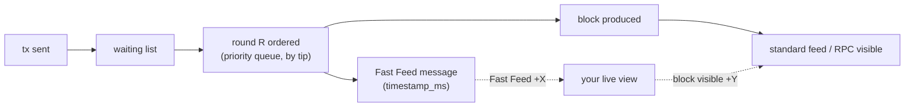

# The Fast Feed: tickets, keys and the live view

Not production: teaching code, throwaway wallets only. This page needs no PGA knowledge and can be followed alone (Node >= 22 and Foundry, see [docs/setup.md](../docs/setup.md)).

The Fast Feed is a WebSocket that publishes each transaction right after the sequencer orders it, before its block exists. It is not public: you connect with an API key, and the key must be backed by a **ticket**.
Concepts: [Fast Feed](https://docs.arbitrum.io/how-arbitrum-works/priority-gas-auction/fast-feed). How to buy and use tickets: [Use the Fast Feed](https://docs.arbitrum.io/how-arbitrum-works/priority-gas-auction/use-fast-feed).

**Where the code is.** `fast-feed/client/` is the client side: `client.ts` (connection, decoding, the error map), `feed.ts` (the `npm run feed` CLI), `live.ts` (the live view), `tickets.ts` and `tickets-cli.ts` (buying), `key.ts` and `access.ts` (the key hash and the active-ticket rule), `abi.ts`. `fast-feed/mock/` is the local mock feed (`feed.ts`) and its ticket check (`auth.ts`). The stack they run on is [sim/README.md](../sim/README.md).

## Quickstart: from nothing to a decoded feed message

`--local` runs everything on your laptop. Three terminals.

**Terminal 1**: the simulator (Anvil, mock sequencer, mock feed, deployed ticket contracts). It prints a banner with every accelerated value next to Arbitrum One's and keeps running; Ctrl-C stops it, Anvil included.

```bash
npm ci
npm run sim
```

**Terminal 2**: a key, a ticket, the feed.

```bash
npm run key:new                              # random feed key into .env; prints only its keccak256 hash
npm run tickets:buy -- --local --tickets 1   # mint, approve, deposit, read round and price, purchase
npm run feed -- --local                      # answers 401 until the ticket activates
```

`tickets:buy` prints when access starts (`access starts at ... (in 23s)`). A ticket bought in round N is active in round N+1 only, so rerun `npm run feed -- --local` after that time and it prints `connected` (or add `--reconnect` to let it retry). Every refusal code, its cause and its fix is in the [error table](#errors-the-single-table).

**Terminal 3**: send a transaction with the public key of Anvil dev account 0 (local only; `cast` is in `~/.foundry/bin` if it is not on your `PATH`).

```bash
cast send 0x000000000000000000000000000000000000dEaD --value 1 \
  --private-key 0xac0974bec39a17e36ba4a6b4d238ff944bacb478cbed5efcae784d7bf4f2ff80 \
  --rpc-url http://127.0.0.1:8547
```

`cast` waits for the receipt. The feed terminal has already printed the decoded message, **before** the block is visible, followed by when the block became visible:

```
==> connected
feed message:
  block_number: 27 (tentative)
  tx_index:     0
  tx_hash:      0xffd16a6c30a01d77476297d7afc04230ac3252ce3b6a11484c8995e30ee1c311
  from:         0xf39Fd6e51aad88F6F4ce6aB8827279cffFb92266
  tip:          39968840 wei (effective_gas_price 49968840 - base_fee 10000000)
  status:       1 (success)
    block 27 visible on RPC +1088ms after the feed message
```

(Hash, block and timing vary. The message leads block visibility by more than `BLOCK_PUBLISH_DELAY_MS` and at most one block time B plus `BLOCK_PUBLISH_DELAY_MS`; B is 2000ms by default. `(tentative)` marks a block number taken from the feed, before the block is visible on the RPC.) That gap is the point: the feed tells you about a transaction after it is ordered and before its block is produced. `--raw` also prints the JSON.

Then watch whole rounds, with background load (terminal 1 still running):

```bash
npm run traffic -- --local --tps 5     # terminal 3: other wallets send txs with random tips
npm run feed -- --local --live         # terminal 2: one table per round, see "Live view" below
```

Add `--reconnect` to the feed command to survive refusals and rollovers ([`--reconnect`](#--reconnect)). To explore the feed without tickets, start the simulator with `FEED_AUTH=off npm run sim` ([local feed auth](#parameters)). One ticket allows one connection: a second terminal with the same key is refused with `429`. If a port is busy, see [docs/setup.md](../docs/setup.md#port-conflicts).

## Tickets and keys

- A **ticket** is bought from the `Tickets` contract with a payment token (USDG on Arbitrum One, the Offchain Labs test token on Sepolia, the local USDGTest locally). One ticket allows one feed connection (see [One connection per ticket](#one-connection-per-ticket)). The price moves between rounds with demand; within a round it is fixed.
- An **API key** is a random secret you generate. You never send it on chain; you send its **keccak256 hash** (`apiKeyHash`) with the purchase. The feed receives the raw key as `Authorization: Bearer <key>`, hashes it, and looks for a ticket purchased for that hash. This repo hashes the key's UTF-8 bytes (`fast-feed/client/key.ts`); `cast keccak <key>` gives the same value for a key without a `0x` prefix, and `npm run key:new` generates such keys.
- Tickets are sold per **round**. The contract's `roundNumber()` and `currentPrice()` change with time; a purchase must name the round and price you read, so a rollover between read and purchase fails instead of silently charging the new price.

## Buying: the steps

`npm run tickets:buy -- --local --tickets 1` narrates each one:

1. **mint** (local only): the local USDGTest token has a public `mint`.
2. **approve** the Tickets contract: it pulls tokens with `transferFrom`.
3. **`depositToken(amount)`**: tokens move into the contract's internal balance.
4. **read** `roundNumber()` and `currentPrice()` (plus `roundEnd()`, `grandfatherPeriodEnd()` and your `grandfatherCount`).
5. **`purchaseTickets(round, price, n, keccak256(key))`**: debits `price * n` from the deposited balance and records the hash.
6. **status / withdraw**: `npm run tickets:status` shows balances, round, price, your tickets and the key's active tickets in the current round and when they expire. `npm run tickets:withdraw` takes back the unused deposit (all of it, or `--amount <tokens>`, in whole tokens).

If the round or price moved, you get a readable message such as `Round changed (expected 3, now 4): ... rerun the command.` Rerun it.

**Grandfather period.** The first part of each round is reserved for holders of previous-round tickets, who may buy up to the number they held. Outside it anyone may buy. Locally the period is 0 (none); on Arbitrum One it is about half the round (128/256). The rule applies from round 1 on (round 0 has no previous round, as in the contract). If the period blocks you, `tickets:buy` stops cleanly with a one-line explanation and exit status 1, no stack trace.

## Timing: buy in round N, active in round N+1 only

**A ticket bought in round N is active for round N+1 only.** It does nothing in round N, and it is gone in round N+2. "When does my ticket start working? At the end of the round in which you buy it. It stays active until the end of the next round." ([Use the Fast Feed](https://docs.arbitrum.io/how-arbitrum-works/priority-gas-auction/use-fast-feed), Step 6 and FAQ.)

- The active tickets of a key in round R are the sum of `numTickets` over the `TicketsPurchased` events for its hash with `round == R - 1`. Zero active tickets means `401`.
- Shortly after a round ends, the endpoint closes every connection whose key holds no ticket in the new round (close `1008`). A key with a ticket in both rounds keeps its connection.
- **Renew every round.** Buy again before `roundEnd` in each round, usually with a bot. The overlap is what keeps the connection open across a rollover. For production-style renewals use the official renewal bot, not this workshop CLI: https://github.com/OffchainLabs/feed-ticket-contracts/tree/main/bot
- `npm run tickets:buy` prints when access starts. `npm run tickets:status` reports the key's active tickets in the current round, and says `expires at <roundEnd>; renew before then`.

## One connection per ticket

"You open one connection per ticket, and each connection receives the full feed." With 2 active tickets you may hold 2 connections; a third is refused with `429` (see the table below). Close one, or buy more tickets for the next round.

## Errors: the single table

Every refusal or close code the feed can produce, with its cause and fix. The client (`fast-feed/client/client.ts`) holds the same text in one map, and `npm run feed` prints it. Source: [Use the Fast Feed](https://docs.arbitrum.io/how-arbitrum-works/priority-gas-auction/use-fast-feed), Troubleshoot, "Connection rejected or closed".

| Response | Cause | Fix |
|---|---|---|
| HTTP 401 Unauthorized | The Authorization header is missing, or the key's hash has no active ticket. | Check the raw key and its hash. Tickets bought this round activate at roundEnd. |
| HTTP 429 Too Many Requests | The key already has as many open connections as it has active tickets. | Close a connection, or buy more tickets for the next round. |
| HTTP 426 Upgrade Required | The request was not a WebSocket upgrade, for example a plain HTTPS GET. | Use a WebSocket client. |
| Close 1008, `authentication expired` | The round ended and your key holds no ticket in the new round. | Buy before roundEnd each round, then reconnect. |
| Close 1013, `client lagged` | Your client fell more than 2048 messages behind. | Drain the socket faster. Move parsing and processing off the read loop, then reconnect. |
| Close 1003, `unexpected client message` | Your client sent a data frame. | Send only ping and pong frames. |
| Close 1011, `server shutting down` | The endpoint restarted. | Reconnect with a short backoff. |

One more rule that is not a table row: complete the WebSocket upgrade within 5 seconds.

On a close the CLI prints one line, for example `closed 1008 (ticket expired). Renew: npm run tickets:buy -- --local` (`--testnet` on the testnet), then the cause. A refusal prints the HTTP status, the server's reason and the cause and fix.

## `--reconnect`

`npm run feed -- --local --reconnect` keeps the feed running through the cases above. After `401`, `429`, `1008`, `1011`, `1013` and a lost connection it waits with exponential backoff (1s, 2s, 4s ... capped at 30s (`FEED_BACKOFF_MAX_MS` lowers the cap, e.g. for tests), with jitter; each wait is printed) and tries again; a successful connection resets the backoff. It never retries after `1003` (a client bug) or `426` (not a WebSocket client). Ctrl-C stops it. Without `--reconnect` the command exits non-zero on the first refusal or close.

Typical renewal loop: your ticket expires (`1008`), you run `npm run tickets:buy`, and the reconnecting feed gets `401` until the new ticket activates at the end of the round, then prints `connected`.

> **`--local` vs `--testnet`**
> - Mint is local-only. On Arbitrum Sepolia you get the test token from Offchain Labs via Discord; if your wallet is short of it, `tickets:buy --testnet` prints that minting is not possible there (and the deposit then fails with a readable error).
> - `--local` needs a running simulator (`npm run sim`) because tickets live in its chain. `--testnet` needs `PRIVATE_KEY` for a funded throwaway wallet.
> - The local ticket round is 30s (Arbitrum One: 24 hours), so a ticket expires within about a minute (the round it is bought in plus one) and you can watch `1008` happen. With slow blocks it is raised automatically, and `TICKET_ROUND_SECONDS` overrides it; the rule and its `NOTE:` lines are in [sim/README.md](../sim/README.md#ticket-round-adaptive).
> - The mock simulates `401`, `429`, `426`, `1008`, `1003` and `1011`. It counts open connections per key hash when the upgrade arrives (one per active ticket).
> - `1013 client lagged` is **not simulated locally**: the mock never drops slow clients. The client still explains it.
> - Local simulator note (not in the table above): if the mock cannot read the Tickets contract while checking a key, it answers `503 Service Unavailable` ("could not read Tickets; retry"). `--reconnect` retries it.
> - If a key holds fewer tickets in the new round than it has open connections, the mock closes the excess ones, newest first, with `1008`. This is an assumption: the docs only say a key with no ticket loses its connections.
> - Everything else, including the commands and the key hashing, is the same code path.

## Live view

`npm run feed -- --local --live` turns the feed into one table per PGA round, next to the clock that shows how early you saw it. Why rows are sorted by tip: [pga/README.md](../pga/README.md).

Setup is the [quickstart](#quickstart-from-nothing-to-a-decoded-feed-message): the simulator, `npm run traffic -- --local --tps 5` for background load, a ticket that has activated, then `npm run feed -- --local --live`. Excerpt of a real run (hashes and timings vary; two blocks of the scrolling line mode):

```
── block 46 · round 1 · 4 txs ──
   tx_index  from         to           bid (maxPriorityFee / maxFee)  effective tip     gas used   fee paid
   0         0xBcd4…4096  0x0000…dead  0.096347349 / 1.01 gwei        0.096347349 gwei  21000 gas  0.000002233294329 ETH
   1         0x8626…1199  0x0000…0d01  0.093566347 / 1.01 gwei        0.093566347 gwei  21000 gas  0.000002174893287 ETH
   2         0xdD2F…44C0  0x0000…0d01  0.053270456 / 1.01 gwei        0.053270456 gwei  21000 gas  0.000001328679576 ETH
   3         0x71bE…5788  0x0000…0d01  0.029931231 / 1.01 gwei        0.029931231 gwei  21000 gas  0.000000838555851 ETH
ordered (round 1) → Fast Feed +23ms → block 46 visible on RPC +1080ms
   FF lead  block 46 round 1/2  tx_index 0  +1.08s
   FF lead  block 46 round 1/2  tx_index 1  +1.08s
   FF lead  block 46 round 1/2  tx_index 2  +1.07s
   FF lead  block 46 round 1/2  tx_index 3  +1.07s
```

(The round 2 table of the same block follows; its rows lead by only about +0.07s, see [FF lead](#the-panel-and-ff-lead).)

To see your own tx, send one with a tip above the traffic's 0.1 gwei (give `--gas-price` too: `cast`'s own max-fee estimate is below a 1 gwei tip and it refuses):

```bash
cast send 0x000000000000000000000000000000000000dEaD --value 1 --gas-price 2gwei --priority-gas-price 1gwei \
  --private-key 0xac0974bec39a17e36ba4a6b4d238ff944bacb478cbed5efcae784d7bf4f2ff80 --rpc-url http://127.0.0.1:8547
```

It appears highlighted at the top of its round's table (tip 1 gwei beats the traffic).

**Header.** The ticket round your key is active in (round number, time left) and how many active tickets the key holds. With `FEED_AUTH=off` it says `feed auth is off; no ticket needed`.

**Tables.** One per `(block_number, pga_round)`, labelled `block 12 · round 1` (a stream without `pga_round` is grouped by block only). A table is printed when the round is complete: when a message for another round arrives, or after 300ms of silence.

| Column | Meaning |
|---|---|
| `tx_index` | Position in the round (the message's `tx_index`); where it starts is explained in the [index note in pga/README.md](../pga/README.md). |
| `from`, `to` | Sender (recovered from `raw_tx`) and recipient, shortened. |
| `bid (maxPriorityFee / maxFee)` | What the sender offered, decoded from `raw_tx`, in gwei. A legacy tx shows its `gasPrice`. |
| `effective tip` | `effective_gas_price − base_fee` from the receipt, in gwei. This is what the table is sorted by. |
| `gas used` | `gas_used` from the receipt. |
| `fee paid` | `gas_used × effective_gas_price`, in ETH. |

**Timing line.** Printed once per round, from the round's first message, as soon as the block is visible on the RPC:

```
ordered (round 1) → Fast Feed +42ms → block 12 visible on RPC +1853ms
```

`ordered` is the message's `timestamp_ms`. **Fast Feed +X** is when the message reached you, minus `timestamp_ms`. **block N visible +Y** is the time from that message until `eth_getBlockByNumber(N)` on the RPC returns a block (polled every 20ms, backing off to 200ms). So Y is how much earlier than the block you saw the round. The line names its block, because it can appear after the next table.

**FF lead (line mode).** Once a block is visible on the sequencer RPC, each round's timing line is followed by one line per row (`>>` marks yours):

```
   FF lead  block 12 round 1/2  tx_index 3  +1.25s
>> FF lead  block 12 round 2/2  tx_index 7  +0.40s
```

The tables are already on screen by then, so the lead arrives as lines, not as a column. `round 1/2` needs K, which the local stack knows; `--testnet` shows `round 1`. Not printed for a block that never became visible within the wait.

## The panel and FF lead

On a terminal, chapter 4 of `npm run demo -- --local` (the block story) draws **one panel redrawn in place** (cursor up, clear, redraw, at most every 100ms; the cursor is hidden meanwhile and restored on every way out: normal end, Ctrl-C, an error). It shows only the **open block** and the **previous, closed block**, 80 columns at most (in the demo's chapter 4, once the story's block X is known, the panel shows only block X, with `round R` headers above their rows):

```
block 7 [closed]: visible on the sequencer RPC, +12.6s after its first feed row
   index  from         effective tip  FF lead
  round 1/2 · 3 txs
>>     0  0xf39F…2266  1 gwei         +12.65s  <- yours
       1  0x7099…79C8  0.062 gwei     +12.65s
       2  0x3C44…93BC  0.017 gwei     +12.64s
  round 2/2 · 2 txs
       3  0x9965…A4dc  0.071 gwei     +0.15s
       4  0x90F7…b906  0.004 gwei     +0.15s
block 8: not visible on the sequencer RPC yet, +6.3s
   index  from         effective tip  FF lead
  round 1/2 · 2 txs
       0  0x15d3…6A65  0.093 gwei     -
       1  0x976E…0aa9  0.011 gwei     -
  round 2/2: not ordered yet
```

- **Rows appear per round** under the open block, labelled `round 1/2`, `round 2/2`, while the status line counts up: `block N: not visible on the sequencer RPC yet, +6.3s` (seconds since the block's first feed row).
- **The block closes** when a direct read of the sequencer RPC (`eth_getBlockByNumber`, the same probe as the timing line) returns it. Then the `FF lead` column fills in for every row and the block is marked `[closed]`.
- **FF lead = block visible on a direct sequencer read minus the moment the feed message arrived.** It is how much earlier the Fast Feed showed that tx than a direct read of the sequencer for the finalized block would have. Round 1 rows lead by about one round (B/K); round 2 rows lead only by a small amount (about the block publish delay plus the poll), because the block is revealed right after its last round. A lead is never negative: a row that arrived after its block was already visible shows `+0.00s`.
- **The roll.** When the next block opens, the closed block becomes "previous" and the older one disappears.
- A tall panel is cut to the terminal height with `... N more txs`; your rows are kept.
- `NO_COLOR` does not stop the redraw (cursor movement is not colour): the panel is drawn without colour codes. A non-terminal stdout, or `TERM=dumb`, gets the line mode above instead (tables, timing line and FF lead lines); the demo's chapter 4 then prints just the two rounds of its one block, with the FF lead as a column of its timing table. `npm run feed -- --live` keeps the scrolling line mode.

**"Yours".** Rows whose `from` is your wallet are marked `>>` (and bold on a terminal) and labelled `yours, tip 1 gwei, index 0 of round 1`. "Your wallet" is the address of `PRIVATE_KEY`, else Anvil dev account 0 locally (the CLI's default wallet), plus any comma-separated addresses in `MY_ADDRESSES`. Locally, Anvil dev account 0 is always included, even when `PRIVATE_KEY` is set. A row whose tip is above the row before it is annotated `out of tip order (nonce-gated / boosted)`; background traffic never produces one.



The footer, printed on exit and every 10 rounds: "within each round, rows are sorted by tip. That's PGA. You saw them before the block existed. That's the Fast Feed."

When the ticket round ends without a renewal, the connection closes and the view prints the `1008` explanation from the [error table](#errors-the-single-table).

> **`--local` vs `--testnet` (live view)**
> - With `--local` the view also prints, under the header, the local values it depends on (block and round time, ticket round) next to the Arbitrum One ones. On `--testnet` there is nothing to accelerate, so it does not.
> - Locally and on Arbitrum several rounds share a block, so you see `round 1`, `round 2` for the same block; `tx_index` counts block-wide, and "yours" shows the index within the round ([why](../sim/README.md#k-rounds-per-block)).
> - On a testnet **X includes clock skew** between the feed server and your machine, because `timestamp_ms` comes from the server's clock. A lead of 0 or less means the clocks disagree, and the line says so. Locally X also includes the mock's execution time ([`timestamp_ms` = order time](../sim/README.md#timestamp_ms--order-time)).
> - `npm run traffic` exists only locally (`--testnet` is refused: it would spam a shared network). It sends from Anvil dev accounts 10-19, one tx in flight per wallet, tips uniform in 0 to 0.1 gwei; it prints its achieved rate every 5s, and says when the rate is capped by "one in flight per wallet" (a receipt appears only once its block is revealed, so one wallet sends a tx every 2-3s with the slow preset).

## Key hygiene

- `.env` is git-ignored; never commit it and never paste the key into a chat, a ticket or a log. `npm run key:new` prints only the hash.
- The hash on chain is public, the raw key is the credential. Anyone with the key can use your ticket's connection.
- **Rotate** by generating a new key (`npm run key:new -- --force`) and buying with its new hash; the old hash simply stops being renewed.
- Use throwaway wallets. `PRIVATE_KEY` is read from env or `.env` and never printed.

## Parameters

| Parameter | Arbitrum One | Arbitrum Sepolia | `--local` (accelerated) |
|---|---|---|---|
| Round duration | 24 hours | 10 minutes (docs) | 30 seconds (adaptive, [sim/README.md](../sim/README.md#ticket-round-adaptive)) |
| Target tickets / round | 100 | read on chain (`tickets:status`) | 100 |
| Max tickets / round | 200 | read on chain | 200 |
| Minimum price / round | $17 (17000000, 6 decimals) | read on chain | 1 USDGTest |
| Price update fraction | 144 | read on chain | 144 |
| Grandfather period | ~0.5 (128/256) | read on chain | 0 (none) |
| Payment token | USDG | test token (`0xca20…1e00`, minted by Offchain Labs) | USDGTest (local 6-decimals ERC20, auto-minted) |
| Block time B / rounds per block K | 250ms / 2 | read empirically (later) | 2000ms / 2 (slow preset; `--preset fast` uses 250ms / 2) |

`npm run sim` prints the local values next to the Arbitrum One ones. The local Tickets contract is the unmodified reference contract (`contracts/src/fast-feed/vendor/`), deployed behind a proxy at stack start; Anvil dev account 9 owns it. The banner prints the local round in use.

**Local feed auth.** `FEED_AUTH=off` (e.g. `FEED_AUTH=off npm run sim`) disables the ticket check so any client connects without a key, for exploring the feed; the banner says whether auth is on. With auth on, a 250ms timer fires a re-check of every open connection as soon as the clock passes `roundEnd`, so a `1008` arrives within about a second of the round end.

## Local clock note

The local chain mines a block only when a transaction arrives, so its latest block timestamp can be minutes old while the Tickets round views depend on `block.timestamp`. The simulator therefore runs `eth_call` / `eth_estimateGas` at `latest` with the block timestamp set to the current wall-clock time (Anvil block timestamps follow wall-clock time), and the feed checks tickets with the same rule. You never see this, except that round numbers always match your clock.

## Command reference

| Command | What it does |
| --- | --- |
| `npm run sim [-- --preset slow\|fast] [--slowmo] [--block-ms MS] [--fifo] [--max-txs-per-round N]` | Runs the local stack in the foreground (flags: [sim/README.md](../sim/README.md#commands-and-environment)). |
| `npm run key:new [-- --force]` | Generates a random feed key into `.env` (`FEED_API_KEY`) and prints only its keccak256 hash. Replacing an existing key needs `--force`. |
| `npm run tickets:buy -- --local\|--testnet [--tickets N]` | Narrated purchase: mint (local only), approve, `depositToken`, read round and price, `purchaseTickets`, then when access starts. Needs a running simulator for `--local`. |
| `npm run tickets:status -- --local\|--testnet` | Wallet and deposited balance, round, price, round end, grandfather end, tickets held, `grandfatherCount`, and the key's active tickets this round and when they expire. |
| `npm run tickets:withdraw -- --local\|--testnet [--amount <tokens>]` | Withdraws your whole deposit, or `--amount` (in whole tokens: USDGTest locally, the network's test token on Sepolia). |
| `npm run feed -- --local\|--testnet [--raw] [--reconnect]` | Connects with `FEED_API_KEY` and prints each message decoded, plus how long after it the block became visible. A refusal or close prints the code, its cause and fix ([table](#errors-the-single-table)) and exits non-zero. `--reconnect`: [retry rules](#--reconnect). With `--local` it starts the stack, or attaches if one already runs. |
| `npm run feed -- --local\|--testnet --live` | The [live view](#live-view): a header, one table per round, a timing line and FF lead lines; yours highlighted `>>` (`MY_ADDRESSES` adds more). |
| `npm run traffic -- --local [--tps N]` | Background load for the live view (needs `npm run sim`): Anvil dev accounts 10-19, one tx in flight per wallet, tips uniform in 0 to 0.1 gwei, default 5 tx/s. Prints the achieved rate every 5s. `--testnet` is refused (it would spam a shared network). |

Environment: `FEED_API_KEY` (written by `key:new`), `FEED_AUTH=off`, `MY_ADDRESSES`, `FEED_BACKOFF_MAX_MS`, `TICKET_ROUND_SECONDS`; see [docs/setup.md](../docs/setup.md#env).
